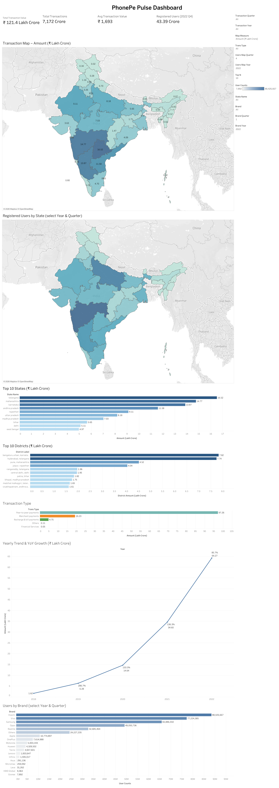

# PhonePe Pulse – Data Visualization & Exploration (Tableau)

An interactive geo-visualization dashboard built in **Tableau Public** on PhonePe Pulse data (2018–2022). It shows transaction and user trends across Indian states and districts.

🔗 **Live Dashboard:** [View on Tableau Public](https://public.tableau.com/app/profile/anjali.nair3836/viz/PhonePePulseDashboard_17940490297660/PhonePePulseDashboard)



---

## 📌 Problem Statement
The PhonePe Pulse GitHub repository contains a large amount of payments data. The goal of this project is to turn that data into a **user-friendly, interactive geo dashboard** with at least **10 dropdown options**, KPIs and growth metrics that give insights into India's digital payments.

## 🗂️ Dataset
Six pre-processed CSV files covering **2018 Q1 – 2022 Q4** at state and district level:

| File | Contents |
|---|---|
| aggregated_transaction.csv | State-wise transactions by payment type (count, amount) |
| aggregated_user.csv | State-wise registered users by mobile brand (till 2022 Q1) |
| map_transaction.csv | District-wise transaction count and amount |
| map_user.csv | District-wise registered users |
| top_transaction.csv | Top districts by transactions |
| top_user.csv | Top districts by registered users |

## 🛠️ Approach
1. **Data modelling:** Combined all 6 files in Tableau using **relationships** on State, Year, Quarter (and District where applicable).
2. **Data cleaning:** Converted state names (e.g. `tamil-nadu`) into a geocodable format with a calculated field, and assigned the State/Province geographic role.
3. **Geo maps:** Built filled maps of transaction value and registered users by state.
4. **Calculated fields:** Amount in ₹ Lakh Crore, transaction count in Crore, average transaction value, district labels, and a map measure switch.
5. **Parameters:** `Top N` (5/10/15/20) and `Map Measure` (Amount / Count).
6. **Growth analysis:** YoY % growth using table calculations, plus CAGR.
7. **Dashboard:** Combined KPIs, maps and charts with dropdown filters and a map click-to-filter action.

## 📊 Dashboard Features
**KPIs:** Total Transaction Value · Total Transactions · Avg Transaction Value · Registered Users

**Charts:** Transaction Map · Users Map · Top N States · Top N Districts · Transaction Type split · Yearly Trend & YoY Growth · Users by Brand

**11 dropdown filters:** Transaction Year · Transaction Quarter · State · Transaction Type · Map Measure · Top N · Users Map Year · Users Map Quarter · Brand · Brand Year · Brand Quarter

**Interactivity:** Clicking a state on the Transaction Map filters the KPIs, Transaction Type, Yearly Trend and Top Districts charts to that state.

## 💡 Key Insights
1. **Explosive growth:** Transaction value grew **~40x**, from ₹1.62 lakh crore (2018) to ₹64.27 lakh crore (2022). That is a **CAGR of ~151%**. Transaction count grew from 108 crore to 3,930 crore.
2. **Growth is maturing:** YoY growth slowed from **287% (2019)** to **86% (2022)** as the base grew larger, while absolute growth kept rising.
3. **South & West lead:** **Telangana (₹16.52 L Cr), Maharashtra (₹14.77 L Cr) and Karnataka (₹13.87 L Cr)** are the top states. The top 3 states account for **37%** of total value, and the top 10 for **~80%**.
4. **Value vs volume:** **Peer-to-peer payments** make up **80%** of transaction value, but **Merchant payments** lead in count (**46%**). Merchant payments are frequent small purchases (avg ₹581), while P2P transfers are larger (avg ₹3,343).
5. **Top districts:** **Bengaluru Urban (₹7.82 L Cr)** and **Hyderabad (₹7.74 L Cr)** are far ahead of the next district, Pune (₹4.52 L Cr).
6. **User base:** Registered users grew from **10.2 crore (2018 Q4) to 43.4 crore (2022 Q4)**. **Maharashtra (5.6 Cr) and Uttar Pradesh (4.56 Cr)** have the most users.
7. **Budget Android dominates:** **Xiaomi (23.7%), Vivo (20.7%) and Samsung (17.7%)** together account for ~62% of users (2022 Q1). PhonePe's reach is strongest among budget and mid-range smartphone users.

## ⚠️ Data Notes
- Registered user counts are **cumulative**, so user figures are shown for a selected quarter (default **2022 Q4**) instead of being summed across quarters.
- Brand-level user data is available only till **2022 Q1**.
- District names are shown with their state (e.g. *Aurangabad, Bihar* vs *Aurangabad, Maharashtra*) to avoid merging districts that share a name.

## 📁 Repository Contents
```
├── PhonePe_Pulse_Dashboard.twbx   # Tableau packaged workbook
├── dashboard.png                  # Dashboard image
└── README.md
```

## 🧰 Tools
Tableau Public · CSV data from PhonePe Pulse

## 👤 Author
**Anjali Nair**
